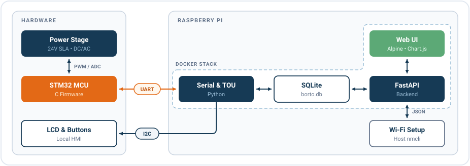

<p align="center">
  
</p>

<h1 align="center">B.O.R.T.O.</h1>
<p align="center">
  <b>Battery-Operated Residential Technology for Ontario</b>
</p>

---

The B.O.R.T.O. is a smart residential energy storage, load-shifting, and uninterruptible power supply system developed by **BBF Inc.**. Designed around Ontario's "time-of-use" (TOU) energy rate structure, the B.O.R.T.O. charges an SLA battery bank during low-cost off-peak hours and discharges power through an AC inverter during peak billing windows to reduce household utility costs while maintaining reliable backup power.

This repository contains the complete software and embedded firmware stack powering the B.O.R.T.O., including real-time microcontroller power-stage firmware, a Raspberry Pi serial bridge, network daemon, and containerized web dashboard.

---

# System Architecture
<div align="center">
  
</div>

The software ecosystem is divided across a **Raspberry Pi** host (orchestrating scheduling, networking, data storage, and the webserver UI) and an **STM32G474RE** microcontroller (managing real-time power electronics and safety protections):

- **Frontend** (`rasp-pi/frontend/`): The frontend is a single-page web dashboard served via Nginx and built with Alpine.js, Pico CSS, and Chart.js for real-time telemetry plotting, system configuration, and interactive troubleshooting.
- **Backend API** (`rasp-pi/backend/`): A FastaPI and SQLAlchemy REST server managing telemetry queries, SoC estimation, TOU configurations, and an outbox command queue backed by a shared SQLite database.
- **Serial Comms** (`rasp-pi/serial/`): A Python daemon communicating with the STM32 over UART (`/dev/serial0`) and driving the local I2C LCD interface, responsible for parsing incoming telemetry frames, evaluating active TOU schedules against the system clock, and dispatching reverse-UART commands. As part of the testing suite, the serial module also contains a built-in hardware cycle simulator.
- **Host Network Provisioning** (`rasp-pi/`): A host-level `nmcli` bash daemon (`network-monitor.service`) that monitors Wi-Fi connectivity and automatically broadcasts a fallback wireless access point (`BORTO_Setup` at [http://10.42.0.1](http://10.42.0.1)) for captive-portal network setup when offline.
- **Embedded Firmware** (`stm32/`): C firmware (using the ST `HAL` driver library) running on the STM32G474RE that governs PWM loops, PI controllers, multi-stage CC-CV battery charging, DC-DC boost conversion, inverter switching, sensor calibration and readings, and hardware fault latching.

---

# Key Features

- **Automated Time-of-Use (TOU) Load Shifting**: Built-in presets for Ontario Winter TOU, Summer TOU, and Ultra-Low Overnight (ULO) rate schedules, plus custom window definitions and configurable SLA minimum reserve SoC floors.
- **Live Telemetry & Analytics**: Real-time monitoring and rolling-average visualizations for various subsystems.
- **Bidirectional Framed UART Protocol**: Reliable custom ASCII framing for telemetry and reverse control, supporting live voltage/current setpoint updates, linear sensor calibration (slope and offset), operating mode transitions, fault-clearing, and safe hardware shutdowns.
- **Zero-App First-Time Setup**: Automatic Wi-Fi Access Point fallback allowing users to connect from any web browser to provide local Wi-Fi credentials.
- **Embedded Operator Manual & Diagnostics**: Searchable dashboard troubleshooting guide with live hardware fault banners for corresponding error codes.

---

# Quick Start (Raspberry Pi Deployment)

## Prerequisites
- Docker & Docker Compose
- NetworkManager (`nmcli`) and `jq` installed on the Raspberry Pi host
- UART (`/dev/serial0`) and I2C (`/dev/i2c-1`) enabled via `raspi-config`

## Running the Application Stack

1. Clone only the `rasp-pi/` directory onto the Raspberry Pi
```bash
git clone --filter=blob:none --no-checkout https://github.com/jtfoote/borto.git
cd borto
git sparse-checkout init --cone
git sparse-checkout set rasp-pi
git checkout
cd rasp-pi
```
2. Build and launch the Docker containers in detached mode:
```
docker compose up -d --build
```
3. Access the web interface:
- **First-Time/Offline Setup**: Connect to the `BORTO_Setup` Wi-Fi network (default password: `bortoinit`) and navigate to [http://10.42.0.1](http://10.42.0.1) to configure your local Wi-Fi.
- **Normal Operation**: Navigate to the local IP address displayed on the B.O.R.T.O. LCD screen from any device on the same network.